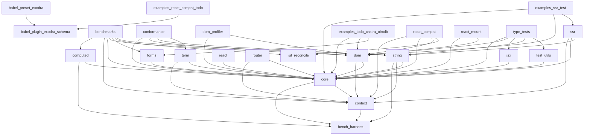

<!-- GENERATED by `npm run graph` — do not edit. `npm run graph:verify` fails on drift. -->

# Package graph

Every edge below is a real `import` found in the sources, not a drawing: the
diagram is regenerated from the code and verified in CI.

The rules these packages must obey (core stays zero-dependency, the two renderers
never reference each other, build-time tooling never reaches the runtime) are
enforced separately by `npm run graph:check`.

